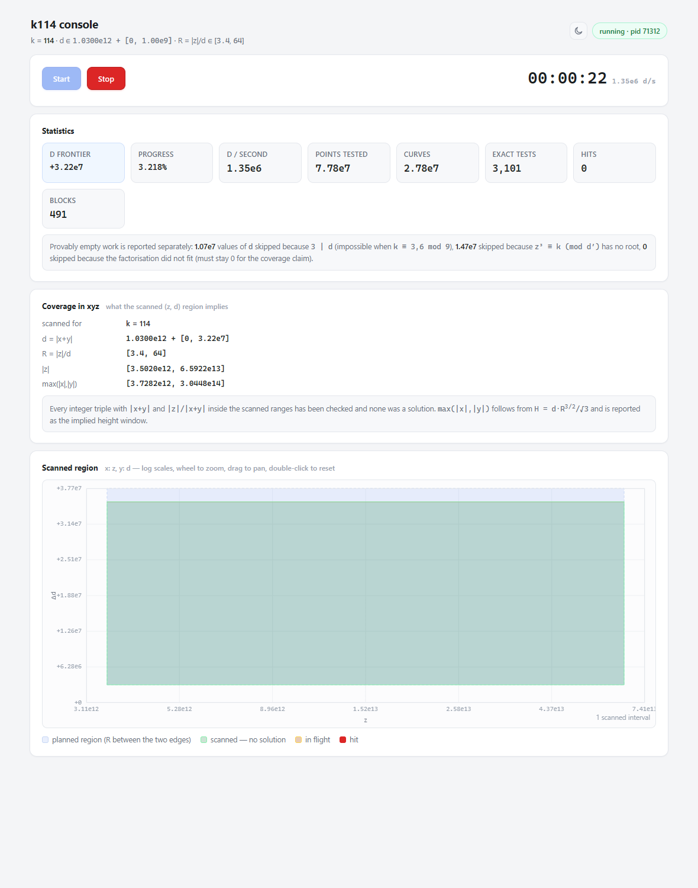

# local-computing

A **personal, local-only** search engine for the sum-of-three-cubes problem, written in Rust.

Target equation:

$$x^3 + y^3 + z^3 = 114$$

---

## What this is

Whether an integer $k$ is a sum of three integer cubes is a Diophantine problem open since 1954. There is no solution when $k \equiv \pm 4 \pmod 9$ (cubes are $0, \pm 1 \bmod 9$). Every other $k$ is expected to have one, but the smallest solution is often astronomically large: $k=33$ needs a solution of size $10^{15}$, $k=42$ of size $10^{16}$, $k=3$ of size $10^{20}$.

After 33 and 42 fell in 2019, **114 became the smallest open case**. Seven values below 1000 remain: 114, 390, 627, 633, 732, 921, 975.

This project is a from-scratch, single-machine implementation of the state-of-the-art search kernel for $k=114$.

## Expectations, stated up front

- The Heath-Brown heuristic gives the expected number of solutions below height $H$ as $0.058459 \ln H$ for $k=114$. **Each additional order of magnitude buys about 5.9% more chance.**
- Up to $10^{17}$ the search has been exhausted by volunteer computing: 2.29 solutions expected, zero found.
- **A laptop will not find 114.** The real deliverables are: a faster, cleaner, self-certifying kernel; a reusable framework for this family of equations; and a bit of Rust performance engineering.
- This project deliberately scans a region that no published search has touched, so that the work is not duplicated. See `docs/DESIGN.md` §3.

## What this is not

- No crowd-sourcing, no submission, no "banks", no network access of any kind.
- No code or data shared with `../k=114` (the Math Gambling console) — that project samples the space and submits receipts; this one scans contiguous regions locally.
- No floating-point verdicts. Every acceptance test is exact integer arithmetic.

## Status

**Working engine and a local console, verified against published solutions.**

- [x] Mathematics, algorithm selection, and survey of every published search range → [`docs/DESIGN.md`](docs/DESIGN.md)
- [x] Region selection (disjoint from all published searches)
- [x] `u256`, exact test, modular filters, cube roots, curve scan, segmented `d` enumeration, CLI
- [x] End-to-end regression on the known solutions for $k=3, 33, 42, 795$, plus brute-force cross-checks for small $k$
- [x] 27 tests green; measured baseline $2.8\times10^{6}$ values of $d$ per second
- [x] Resumable runs (`--resume`) and a `/`-page console with start/stop, statistics and a $(z, d)$ coverage plot
- [ ] Root caching / prime bands (the measured bottleneck)
- [ ] Hit-set cross-check against the reference C implementation `zcubes`
- [ ] Long run on the selected region

## Console

A single page on `127.0.0.1`: start/stop the engine, watch the totals, and see the scanned
region as a picture. `x` is $z$, `y` is $d = |x+y|$, both log-scaled and auto-fitted; the
wheel zooms, dragging pans, a double-click resets. The shaded band is the set of $(z,d)$
pairs already checked and found not to be solutions; the pale outline is what is left.



```bat
console.bat
```

Double-clicking `console.bat` is enough. It opens the console on
`d ∈ [1.4815e18, 2e18)`, uses six worker threads and stores its state in `runs\k114`.
Nothing is scanned until `Start` is pressed. Optional arguments override those defaults
in order: `console.bat [dlo] [dhi] [threads] [out-dir]`.

`Start` resumes from the last checkpointed block, so closing the lid or pressing `Stop`
costs at most one block of work. Closing the console window also terminates the engine
on Windows. The six-thread default leaves two physical cores free; use
`console.bat 1.4815e18 2e18 2` for a lighter footprint. The engine runs below normal
priority by default. The header button switches between light and dark themes and
remembers the choice locally. The timer row also shows the cumulative engine runtime in
hours, stored in `console.json` and carried across restarts.

## Usage

```
k114 --dlo 1481500000000000000 --dhi 1481504194304000000 --threads 2 --out runs/a
```

Scans `d ∈ [dlo, dhi)` with `R = |z|/d ∈ [3.4, 64]`, writes `hits.jsonl`, `progress.log`
and a `region.json` manifest. `--k`, `--rlo`, `--rhi`, `--block` adjust the target and the
region shape; `--resume` continues an interrupted run; `--emit-json` writes machine-readable
progress to stdout (that is what the console reads).

```
cargo test --release          # 27 tests, includes the published solutions
RUSTFLAGS="-C target-cpu=native" cargo build --release
```

## Layout

```
local-computing/
├── README.md            this file
├── docs/DESIGN.md       mathematics, algorithm, architecture
├── Cargo.toml
├── src/
│   ├── u256.rs          fixed-width 256-bit integers
│   ├── exact.rs         the exact acceptance test
│   ├── filters.rs       mod 243 wheel + small-prime quadratic-residue masks
│   ├── roots.rs         cube roots of k mod p^e, CRT
│   ├── dgen.rs          enumeration/factorisation of d over an interval
│   ├── curve.rs         one (d, r) curve: scan the z progression
│   └── main.rs          CLI, region iteration, output
└── tests/known.rs       known-solution regression
```

## The algorithm in one paragraph

Fold $x$ and $y$ away with $d = x+y$, leaving a two-dimensional problem:

$$v^2=\frac{4(k-z^3)-d^3}{3d},\qquad x=\frac{d+v}{2},\;y=\frac{d-v}{2},\qquad v^2 \text{ must be a perfect square}$$

So only $(d,z)$ has to be searched. The condition $z^3\equiv k\pmod{d}$ collapses the valid $z$ into arithmetic progressions, and then mod-243 residue classes, parity, and 15 small-prime quadratic-residue bitmaps reject candidates at a measured rate of about $1:5\times10^5$. The hot loop is only table lookups and integer adds; the exact big-integer square root runs a few times per million points.

## References

- A. R. Booker, A. V. Sutherland, *On a question of Mordell*, PNAS 118(11), 2021 — [arXiv:2007.01209](https://arxiv.org/abs/2007.01209)
- Reference implementation (C, MIT): [`AndrewVSutherland/SumsOfThreeCubes`](https://github.com/AndrewVSutherland/SumsOfThreeCubes)
- S. G. Huisman, *Newer sums of three cubes*, 2016 — [arXiv:1604.07746](https://arxiv.org/abs/1604.07746)
- A.-S. Elsenhans, J. Jahnel, *New sums of three cubes*, 2009
- D. R. Heath-Brown, on the $\sim c\log H$ counting heuristic

This is an unofficial personal implementation, unaffiliated with the authors above. No upstream code is reused.

## Licence

MIT OR Apache-2.0, as declared in `Cargo.toml`. Licence texts not added yet.
